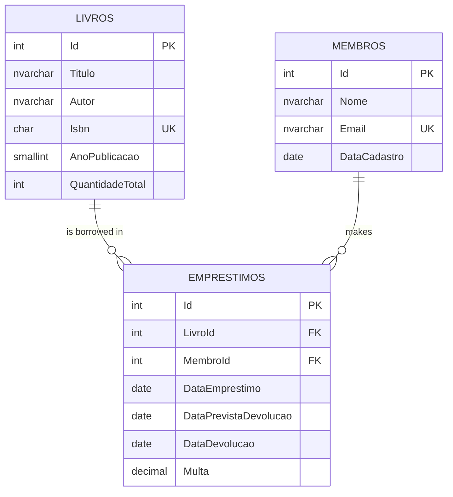

# Library (C#)

🇧🇷 [Português](README.pt-BR.md) · 🇺🇸 English

A book lending system in C# with a SQL Server database. It registers books and members, manages loans and returns, calculates late fees and generates reports. The interface is a console menu.

## Technologies

- C# / .NET 8
- SQL Server (T-SQL) with ADO.NET (`Microsoft.Data.SqlClient`), no ORM
- xUnit for tests

## Structure

```
src/
  Biblioteca.Core   Business rules, models and repository interfaces (no database dependency)
  Biblioteca.Data   Repositories that access SQL Server
  Biblioteca.Cli    Console menu
tests/
  Biblioteca.Tests  Business rule tests
database/
  01_schema.sql         Tables, constraints, indexes and view
  02_dados_exemplo.sql  Sample data
  03_consultas.sql      Example queries (JOIN, GROUP BY/HAVING, RANK)
```

`Core` only knows the interfaces `ILivroRepositorio`, `IMembroRepositorio` and `IEmprestimoRepositorio`. They are implemented by `Data` (SQL Server) or by `BancoEmMemoria`, used in tests and in `--memoria` mode.

## Data model



## Rules

- 14-day loan period. Late fee of R$ 1.00 per day; returning on the last day of the period incurs no fee.
- Each member can have up to 3 books on loan at the same time.
- Members with an overdue book cannot borrow another until they return it.
- ISBN-13 is validated by its check digit and accepted with or without hyphens.
- Email is unique, case-insensitive.

## Decisions

- **Availability is not stored.** The `Livros` table only stores the total quantity; borrowed copies are counted from `Emprestimos` through the `vw_LivrosComDisponibilidade` view. That way the number can never drift from reality.
- **Atomic loans.** `TentarRegistrar` opens a transaction and checks free copies with `UPDLOCK, HOLDLOCK` before the `INSERT`. Two people taking the last copy at the same time cannot both succeed.
- **Rules in the database too.** `CHECK`, `UNIQUE` and foreign keys prevent invalid data even if someone changes the database outside the program.
- **Filtered indexes** (`WHERE DataDevolucao IS NULL`) on ongoing loans, which are the most queried.
- **Parameterized queries** in all data access. Title search uses `COLLATE Latin1_General_CI_AI` (ignores case and accents) and escapes `LIKE` wildcards.
- **Injected current date** (`TimeProvider`), to test delays and fees without depending on the clock.

## Running

Requires the [.NET SDK 8](https://dotnet.microsoft.com/download) or newer.

**Without a database**, with in-memory sample data:

```
dotnet run --project src/Biblioteca.Cli -- --memoria
```

**With SQL Server** (LocalDB, Express or other). Run `database/01_schema.sql` and then `database/02_dados_exemplo.sql` in SSMS or Azure Data Studio. From the terminal, use `-I`, which `sqlcmd` requires because of the filtered indexes:

```
sqlcmd -S "(localdb)\MSSQLLocalDB" -I -i database/01_schema.sql
sqlcmd -S "(localdb)\MSSQLLocalDB" -I -i database/02_dados_exemplo.sql
dotnet run --project src/Biblioteca.Cli
```

The default connection points to `(localdb)\MSSQLLocalDB`. For another server, set the `BIBLIOTECA_CONNECTION` environment variable to the connection string.

**Tests:**

```
dotnet test
```
