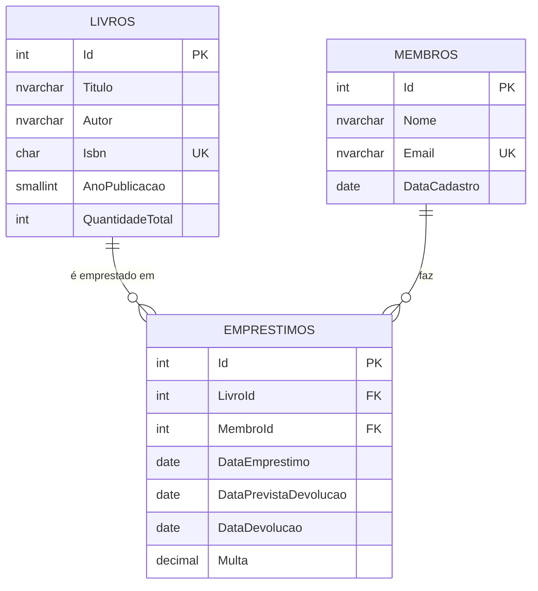

# Biblioteca

🇧🇷 Português · [🇺🇸 English](README.md)

Sistema de empréstimo de livros em C# com banco SQL Server. Cadastra livros e membros, controla empréstimos e devoluções, calcula multa por atraso e gera relatórios. A interface é um menu no console.

## Tecnologias

- C# / .NET 8
- SQL Server (T-SQL) com ADO.NET (`Microsoft.Data.SqlClient`), sem ORM
- xUnit para os testes

## Estrutura

```
src/
  Biblioteca.Core   Regras de negócio, modelos e interfaces de repositório (sem dependência de banco)
  Biblioteca.Data   Repositórios que acessam o SQL Server
  Biblioteca.Cli    Menu no console
tests/
  Biblioteca.Tests  Testes das regras de negócio
database/
  01_schema.sql         Tabelas, restrições, índices e view
  02_dados_exemplo.sql  Dados para testar
  03_consultas.sql      Consultas de exemplo (JOIN, GROUP BY/HAVING, RANK)
```

O `Core` só conhece as interfaces `ILivroRepositorio`, `IMembroRepositorio` e `IEmprestimoRepositorio`. Quem implementa é o `Data` (SQL Server) ou o `BancoEmMemoria`, usado nos testes e no modo `--memoria`.

## Modelo de dados



## Regras

- Prazo de 14 dias. Multa de R$ 1,00 por dia de atraso; devolver no último dia do prazo não gera multa.
- Cada membro pode ter até 3 livros emprestados ao mesmo tempo.
- Quem tem livro atrasado não pega outro até devolver.
- ISBN-13 é validado pelo dígito verificador e aceito com ou sem hífens.
- E-mail é único, sem diferenciar maiúsculas de minúsculas.

## Decisões

- **Disponibilidade não é gravada.** A tabela `Livros` guarda só a quantidade total; os exemplares emprestados são contados a partir de `Emprestimos` pela view `vw_LivrosComDisponibilidade`. Assim o número nunca fica diferente da realidade.
- **Empréstimo atômico.** `TentarRegistrar` abre uma transação e confere os exemplares livres com `UPDLOCK, HOLDLOCK` antes do `INSERT`. Duas pessoas pegando o último exemplar ao mesmo tempo não conseguem as duas.
- **Regras também no banco.** `CHECK`, `UNIQUE` e chaves estrangeiras impedem dado inválido mesmo que alguém altere o banco fora do programa.
- **Índices filtrados** (`WHERE DataDevolucao IS NULL`) nos empréstimos em andamento, que são os mais consultados.
- **Consultas parametrizadas** em todo o acesso a dados. A busca por título usa `COLLATE Latin1_General_CI_AI` (ignora maiúsculas e acentos) e escapa os curingas do `LIKE`.
- **Data atual injetada** (`TimeProvider`), para testar atraso e multa sem depender do relógio.

## Como rodar

Precisa do [.NET SDK 8](https://dotnet.microsoft.com/download) ou mais novo.

**Sem banco**, com dados de exemplo em memória:

```
dotnet run --project src/Biblioteca.Cli -- --memoria
```

**Com SQL Server** (LocalDB, Express ou outro). Execute no SSMS ou no Azure Data Studio os arquivos `database/01_schema.sql` e depois `database/02_dados_exemplo.sql`. Pelo terminal, use `-I`, que o `sqlcmd` exige por causa dos índices filtrados:

```
sqlcmd -S "(localdb)\MSSQLLocalDB" -I -i database/01_schema.sql
sqlcmd -S "(localdb)\MSSQLLocalDB" -I -i database/02_dados_exemplo.sql
dotnet run --project src/Biblioteca.Cli
```

A conexão padrão aponta para `(localdb)\MSSQLLocalDB`. Para outro servidor, defina a variável de ambiente `BIBLIOTECA_CONNECTION` com a connection string.

**Testes:**

```
dotnet test
```
